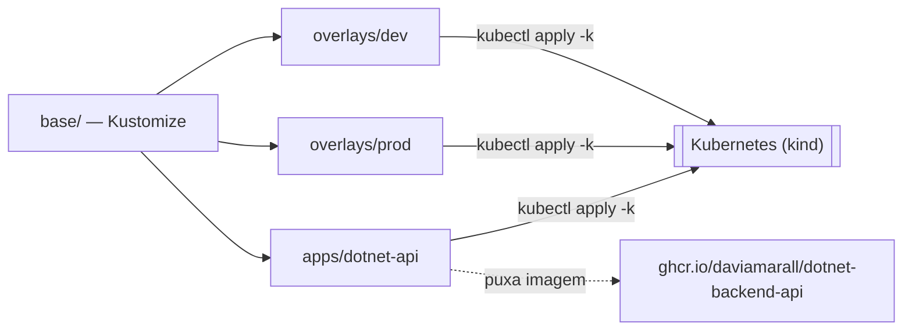

# k8s-lab

[](https://github.com/daviamarall/k8s-lab/actions/workflows/ci.yml)


Manifestos de **Kubernetes** organizados com **Kustomize** (base + overlays), com **probes**, **HPA**, **resource limits** e boas práticas de segurança rodando num cluster local com **kind**.

> Projeto de portfólio focado em **DevOps / SRE / plataforma**.

---

## 🏗️ Fluxo



## 🎯 O que este repositório demonstra

- **Kustomize** com `base` reutilizável e `overlays` (`dev` e `prod`)
- **Deployment** com estratégia de `RollingUpdate` sem downtime (`maxUnavailable: 0`)
- **Liveness & Readiness probes** + `readonly` root filesystem e `runAsNonRoot`
- **requests/limits** de CPU e memória (base para QoS e HPA)
- **Horizontal Pod Autoscaler** (autoscaling/v2) por CPU
- **ConfigMap** e **Secret** (com exemplo e alerta de segurança)
- **Service** ClusterIP + **Ingress** (nginx)
- **Cluster local com kind** (script de criação) para praticar de verdade
- **Validação na CI**: render do Kustomize + `kubeconform` (schema estrito)

## 🏗️ Estrutura (Kustomize)

```
k8s-lab/
├── base/                 # recursos comuns (deployment, service, configmap)
│   └── kustomization.yaml
├── overlays/
│   ├── dev/              # namespace, 1 réplica
│   └── prod/             # namespace, 3 réplicas + HPA + Ingress
├── apps/
│   └── dotnet-api/       # deploy do dotnet-backend-api (imagem do GHCR)
├── kind/kind-config.yaml # cluster local com portas mapeadas
├── scripts/              # create-cluster.sh, deploy.sh
└── .github/workflows/ci.yml
```

## 🚀 Como usar

### Pré-requisitos
- `kubectl`, `kind`, `docker` (e opcionalmente `kustomize`)

### Subir um cluster local e aplicar

```bash
bash scripts/create-cluster.sh
bash scripts/deploy.sh dev
kubectl get pods -n podinfo-dev
```

### Testar o autoscaling (overlay prod)

```bash
bash scripts/deploy.sh prod
kubectl get hpa -n podinfo-prod -w
```

### Só renderizar o manifesto (sem cluster)

```bash
kubectl kustomize overlays/dev
kubectl kustomize overlays/prod
```

## 🔗 Deploy real: `dotnet-backend-api` (GHCR)

O diretório `apps/dotnet-api/` implanta a API do projeto **[dotnet-backend-api](https://github.com/daviamarall/dotnet-backend-api)** — cuja imagem é publicada automaticamente no **GitHub Container Registry** pela sua CI.

Fluxo completo (a "história" que conecta os projetos):

```
dotnet-backend-api  ──CI──▶  ghcr.io/daviamarall/dotnet-backend-api:latest
                                            │
                              kubectl apply -k apps/dotnet-api
                                            ▼
                       Kubernetes (liveness /healthz  ·  readiness /readyz)
```

```bash
kubectl apply -k apps/dotnet-api
kubectl get pods -n dotnet-api
```

## 🔐 Boas práticas aplicadas

| Prática                          | Onde                          |
|----------------------------------|-------------------------------|
| Rodar como não-root              | `deployment.yaml` (securityContext) |
| Bloquear escalonamento de privilégios | `allowPrivilegeEscalation: false` |
| Root filesystem read-only        | `readOnlyRootFilesystem: true` |
| Dropar capabilities              | `capabilities.drop: [ALL]`    |
| Probes de saúde                  | `livenessProbe` / `readinessProbe` |
| Limites de recurso               | `resources.requests/limits`   |
| Segredos fora do Git             | `secret.example.yaml` + `.gitignore` |

## 🧩 Pipeline (`ci.yml`)

| Etapa                | Ferramenta                     |
|----------------------|--------------------------------|
| Render               | `kubectl kustomize overlays/*` |
| Validação de schema  | `kubeconform -strict`          |

## 📄 Licença

MIT — veja [LICENSE](LICENSE).
